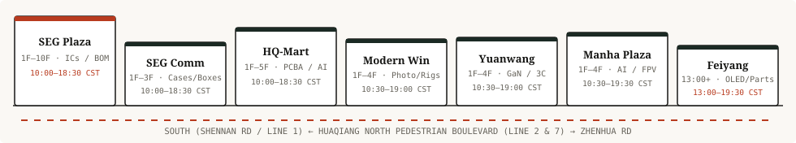

# Shenzhen Huaqiangbei & Hardware Sourcing Field Guide (2026)

An independent, practical English field reference and open JSON dataset (`huaqiangbei-2026.json`) for hardware engineers, product founders, and tech buyers visiting **Huaqiangbei Electronics Market**, **Nanshan EV/robotics showrooms**, and **Greater Bay Area SMT/CNC factories** in Shenzhen, China.

- **Interactive 7-Hall Floor Map, Walking Routes & Fullscreen Booth Cards**: [szfactorytour.com/huaqiangbei-electronics-market.html](https://szfactorytour.com/huaqiangbei-electronics-market.html)
- **SEG Electronics Market 1F–10F Floor Directory**: [szfactorytour.com/guides/seg-electronics-market.html](https://szfactorytour.com/guides/seg-electronics-market.html)
- **BYD & Shenzhen EV Tour Access Reality Guide**: [szfactorytour.com/byd-shenzhen-factory-tour.html](https://szfactorytour.com/byd-shenzhen-factory-tour.html)
- **Shenzhen Hardware Founder Tour & Cost Estimator**: [szfactorytour.com](https://szfactorytour.com/)

---

## 1. The 7 Active Huaqiangbei Electronics Halls (Nov 2026)

> **Visiting window:** Arrive between **11:00 and 17:00 CST**. Most component halls open at 10:00–10:30 and wind down by 18:30. **Feiyang / Tongtiandi** phone-part stalls sleep in until **13:00**.
> **Pitfall alert:** Skip **Mingtong Cosmetics Market (明通化妆品市场)**—outdated travel blogs still list it as a phone/electronics mall, but it converted into wholesale cosmetics.

| Building | Chinese Name & Address | Best For | Nearest Metro Exit | Typical CST Hours |
| --- | --- | --- | --- | --- |
| **SEG Electronics Market** | 赛格电子市场 · 1002 Huaqiang N Rd | Raw ICs, sensors, OLED displays, ESP32/STM32 boards, lab tools (1F–3F sample friendly) | Huaqiang Rd (Line 1 Exit A) / Huaqiang North (Line 2/7 Exit D2) | 10:00–18:30 |
| **SEG Communications Market** | 赛格通信市场 · 1012 Huaqiang N Rd | Phone accessories, TWS modules, custom retail gift boxes & same-day packaging samples (3F) | Huaqiang North (Line 2/7 Exit D2) | 10:00–18:30 |
| **Huaqiang Electronics World (HQ-Mart)** | 华强电子世界 · 1015 Huaqiang N Rd | IC distributors, PCB/PCBA quick-turn desks, AI smart glasses & wearables | Huaqiang North (Line 2/7 Exit A) | 10:00–18:30 |
| **Modern Window Digital Plaza** | 现代之窗数码广场 · 1058 Huaqiang N Rd | Mirrorless cameras, cine lenses, DJI gimbals, studio lighting & audio gear | Huaqiang North (Line 2/7 Exit A) | 10:30–19:00 |
| **Yuanwang Digital Mall** | 远望数码商城 · 2006 Huaqiang N Rd | 2F AI/Robot pavilion, GaN chargers, power banks, wholesale smartphones & export packaging | Huaqiang North (Line 2/7 Exit B) | 10:30–19:00 |
| **Manha Digital Plaza** | 曼哈数码广场 · 2001 Huaqiang N Rd | Newly launched AI consumer gadgets, smart rings, FPV drones, creator rigs | Huaqiang North (Line 2/7 Exit B) | 10:30–19:30 |
| **Feiyang & Tongtiandi Hub** | 飞扬时代 / 通天地 · Zhenhua Rd | OLED replacement screens, camera modules, flex cables, board-level repair | Science Museum (Line 1/6 Exit C, 8-min walk) | 13:00–19:30 |

---

## 2. Three Ordered Walking Routes (Zero Backtracking)

1. **Engineer & BOM Sourcing Walk (3–4h · Best 10:00–14:00)** — [Open Interactive Route →](https://szfactorytour.com/huaqiangbei-electronics-market.html?route=maker-bom)
   - `SEG Plaza (1F–3F)` → `HQ-Mart (1F–2F)` → `SEG Comm (3F retail box samples)`
2. **AI Gadgets, FPV Drones & Creator Gear (Half-Day · Best 10:30–16:00)** — [Open Interactive Route →](https://szfactorytour.com/huaqiangbei-electronics-market.html?route=ai-drone)
   - `HQ-Mart (3F–4F)` → `Manha Plaza (1F–2F)` → `Yuanwang (1F–2F)` → `Modern Window`
3. **Smartphones, OLEDs & Board Repair (Afternoon · Start 13:00+)** — [Open Interactive Route →](https://szfactorytour.com/huaqiangbei-electronics-market.html?route=phone-parts)
   - `Yuanwang (3F–4F)` → `SEG Comm (1F–2F)` → `Feiyang & Tongtiandi (peak after 13:30)`

---

## 3. Show-to-Booth Mandarin Quote Cheat Sheet

> Tap **Show Fullscreen** on the [interactive Huaqiangbei map](https://szfactorytour.com/huaqiangbei-electronics-market.html#booth-cards) to display high-contrast Chinese cards at the counter or copy Mandarin directly into WeChat.

| Topic | English | Mandarin (Show to Booth) | Pinyin |
| --- | --- | --- | --- |
| **Sample vs. Bulk** | Can I buy 1–2 samples today? What is the unit price for 100 pcs? | 老板好，这款今天可以拿 1–2 个样品吗？100 个起订的单价是多少？ | `Lǎobǎn hǎo, zhè kuǎn jīntiān kěyǐ ná yī liǎng gè yàngpǐn ma? Yībǎi gè qǐdìng de dānjià shì duōshǎo?` |
| **Authentic IC Check** | Is this brand-new original stock? What is the manufacturing date code (DC)? | 请问这是全新原装正品吗？是什么年份批次（DC）的货？ | `Qǐngwèn zhè shì quánxīn yuánzhuāng zhèngpǐn ma? Shì shénme niánfèn pīcì (DC) de huò?` |
| **Datasheet & WeChat** | Can I add your WeChat to get the English datasheet and tiered price sheet? | 方便加个微信，发一份英文规格书（Datasheet）和阶梯报价单给我吗？ | `Fāngbiàn jiā gè Wēixìn, fā yī fèn Yīngwén guīgéshū hé jiētī bàojìadān gěi wǒ ma?` |
| **Battery & Export** | Does this lithium-battery product have UN38.3, MSDS, and CE/FCC reports for international air shipping? | 这款带锂电池的产品有 UN38.3、MSDS 和 CE/FCC 认证报告吗？我们要发国际空运。 | `Zhè kuǎn dài lǐdiànchí de chǎnpǐn yǒu UN38.3, MSDS hé CE/FCC rènzhèng bàogào ma? Wǒmen yào fā guójì kōngyùn.` |
| **Custom OEM / MOQ** | What is the MOQ and lead time in days if we customize our own logo and retail box? | 如果定制我们自己的 Logo 和包装盒，起订量（MOQ）多少？交期几天？ | `Rúguǒ dìngzhì wǒmen zìjǐ de Logo hé bāozhuānghé, qǐdìngliàng (MOQ) duōshǎo? Jiāoqī jǐ tiān?` |
| **Direct Factory Check** | Do you own an SMT or assembly factory in Bao'an or Dongguan that we can visit this week? | 你们在宝安或东莞有自己的贴片/组装工厂吗？这两天方便去参观吗？ | `Nǐmen zài Bǎo'ān huò Dōngguǎn yǒu zìjǐ de tiēpiàn / zǔzhuāng gōngchǎng ma? Zhè liǎng tiān fāngbiàn qù cānguān ma?` |

---

## 4. BYD & Shenzhen EV / Robotics Access Reality

Can walk-in international travelers tour BYD's active Pingshan assembly floor? **No**—active vehicle and Blade Battery lines require an official corporate, investor, or dealer invitation. See the full [BYD & Shenzhen EV Tour Guide](https://szfactorytour.com/byd-shenzhen-factory-tour.html).

---

## 5. Fast Logistics from Hong Kong & Payments

- **Fastest crossing:** Hong Kong West Kowloon High-Speed Rail → Shenzhen Futian Station (**14 minutes rail** + co-located immigration in one terminal + 10 min metro/DiDi to Huaqiangbei). Full breakdown: [Hong Kong to Huaqiangbei Transit Guide](https://szfactorytour.com/guides/hong-kong-to-huaqiangbei.html).
- **Payments:** Link foreign Visa/Mastercard inside **Alipay** and **WeChat Pay** before landing (0% international card fee on transactions ≤ 200 RMB). Setup checklist: [Alipay, WeChat Pay & DiDi Guide](https://szfactorytour.com/guides/alipay-wechat-pay-shenzhen.html).
- **Prototyping & Factory Audits:** [72-Hour Shenzhen Rapid Prototyping](https://szfactorytour.com/guides/shenzhen-rapid-prototyping.html) · [Shenzhen Hardware Founder Tour](https://szfactorytour.com/shenzhen-hardware-tour.html) · [6-Point Factory Audit Checklist](https://szfactorytour.com/shenzhen-factory-tour.html).

---

*License: CC BY 4.0. Open dataset included in [`huaqiangbei-2026.json`](./huaqiangbei-2026.json).*
